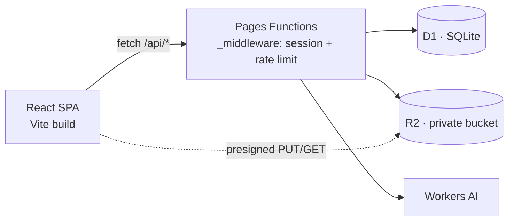

# WalletWise

**A personal finance app that runs entirely on Cloudflare's edge** — accounts, a real
transaction ledger, monthly budgets, transfers, analytics, and AI-assisted spreadsheet
import, on Workers, D1, R2 and Workers AI.

[Live app](https://walletwise-15b.pages.dev) · [Architecture](docs/adr/001-cloudflare-fullstack-architecture.md) · [API](docs/api/README.md) · [Security policy](SECURITY.md) · [Audit](audit.md)

[](https://github.com/w1ztechsolutions/WalletWise/actions/workflows/ci.yml)

---

## Why it exists

Most personal finance apps want your bank credentials, or your data on their servers.
WalletWise is the opposite: a full app that fits in one Cloudflare project, keeps every
row scoped to the authenticated user, and stores receipt images in a private bucket you
own. Sign-up to first transaction takes about a minute.

It is also a worked example of the whole stack on one platform — Pages Functions for the
API, D1 for relational data with Drizzle, Better Auth on D1, R2 with presigned URLs for
uploads, and Workers AI for parsing messy spreadsheets into real rows.

## Features

| | |
| :-- | :-- |
| **Accounts** | Multiple wallets with balances, types and masked account numbers |
| **Ledger** | Income and expenses linked to accounts, with categories, notes and receipt attachments |
| **Transfers** | First-class transfers between accounts in a dedicated table, so balances stay consistent |
| **Budgets** | Monthly per-category budgets with progress against actual spend |
| **Analytics** | Date-ranged summaries, category breakdowns and trends |
| **AI import** | Upload a CSV/XLSX; Workers AI normalizes rows into transactions or budgets, with a deterministic parser as fallback when the model is unavailable |
| **Receipts** | Upload to private R2 via 15-minute presigned URLs, scoped to `users/{userId}/` |
| **Exports** | Date-range CSV export of transactions |
| **Account deletion** | Soft-delete with a recovery window, read-only enforcement while pending, and a scheduled purge worker that actually removes the data |
| **Isolation** | Every query is filtered by `created_by_id`; foreign ids answer `404`, never `403` |

## Stack

| Layer | Choice |
| :-- | :-- |
| UI | React 19, TypeScript, Vite, Tailwind CSS v4, Lucide icons, Recharts |
| Data fetching | TanStack Query with user-scoped cache keys |
| API | Cloudflare Pages Functions (`functions/api/**`), one file per route |
| Database | Cloudflare D1 (SQLite) via Drizzle ORM, migrations in `drizzle/` |
| Auth | Better Auth on D1 (email + password), HTTP-only session cookies |
| Files | Cloudflare R2, private, SigV4 presigned GET/PUT/DELETE via `aws4fetch` |
| AI | Cloudflare Workers AI — `@cf/meta/llama-3.3-70b-instruct-fp8-fast` |
| Tests | Playwright (desktop + mobile projects), Oxlint, `tsc -b` |
| CI/CD | GitHub Actions → Cloudflare Pages Git integration |

## Architecture



Requests to `/api/*` pass through `functions/_middleware.ts`, which mints a request id,
applies per-IP and per-user rate-limit buckets, resolves the Better Auth session, injects
`userId`, and blocks writes while an account deletion is pending. Handlers never trust a
client-supplied user id.

## Run it locally

Requires **Node 26** (pinned in `.nvmrc`) and a Cloudflare account for the remote path.

```bash
git clone https://github.com/w1ztechsolutions/WalletWise
cd WalletWise
npm ci

# front end only (Vite dev server, no /api)
npm run dev

# full stack: Functions + local D1 in the Workers runtime
npm run db:migrate:local
npm run build
npm run pages:dev
```

### Configuration

Local secrets live in `.dev.vars` (gitignored). Start from `.dev.vars.example`:

| Variable | Purpose |
| :-- | :-- |
| `BETTER_AUTH_SECRET` | Signing secret for sessions. Required outside production defaults |
| `BETTER_AUTH_URL` | Public origin, used for cookie and origin checks |
| `R2_ACCOUNT_ID`, `R2_ACCESS_KEY_ID`, `R2_SECRET_ACCESS_KEY` | R2 S3-API credentials for presigning |
| `R2_BUCKET_NAME` | Bucket name (defaults to `walletwise-storage` in `wrangler.jsonc`) |

Cloudflare resources: one D1 database (`walletwise-db`), one private R2 bucket, and the
Workers AI binding. Bindings are declared in `wrangler.jsonc`.

## Tests and gates

```bash
npx tsc -b          # type check
npm run lint        # oxlint
npm run build       # tsc -b && vite build
npm run test:e2e    # Playwright, desktop + mobile
```

CI (`.github/workflows/ci.yml`) runs the type check, lint, build and the credential-free
smoke suite on every pull request and on `main`. `main` is protected and requires the
`Type, lint, build` check.

The data-mutating specs are opt-in and **skip silently without credentials** — set
`E2E_EMAIL` and `E2E_PASSWORD` to run the full suite, which writes to the configured D1
database. This is tracked as DOC-06 in `audit.md`, not hidden.

## Security

`SECURITY.md` is the enforced spec: per-user query scoping, no client-side token storage,
sanitized error envelopes, 15-minute signed URLs, parameterized SQL, rate limiting, and
server-side ownership checks on every object key.

Credentials and `.dev.vars` are gitignored; GitHub secret scanning with push protection is
enabled on this repository. To report a vulnerability, email
**wiztechsol.info@gmail.com** with reproduction steps — please allow reasonable time for a
fix before public disclosure.

## Project documents

| Path | What it is |
| :-- | :-- |
| `AGENT.md` | Working rules, documentation mandates, quality gates |
| `PLAN.md` | Specification, schema, phased roadmap |
| `audit.md` | Living audit trail: findings, severities, evidence, remediation |
| `docs/adr/` | Architecture decision records |
| `docs/bugsnfix/` | Root-cause write-ups per fixed bug |
| `docs/api/` | Endpoint contracts |
| `SECURITY.md` | Security architecture and reporting |

## Status and known gaps

Pre-1.0 and honest about it. Tracked in `audit.md`:

- No email verification or password reset flow yet (SEC-08).
- Rate limiting is per-isolate; a global Cloudflare WAF rule is still recommended (SEC-10).
- The app is served from its `pages.dev` host until a custom domain is attached (OPS-01).
- Browser-level hardening headers (CSP, HSTS, `frame-ancestors`) are not in place yet (SEC-07).

## License

No license has been chosen yet, so the code is currently all rights reserved. Open an
issue if you want to use it and the maintainer will pick one.
